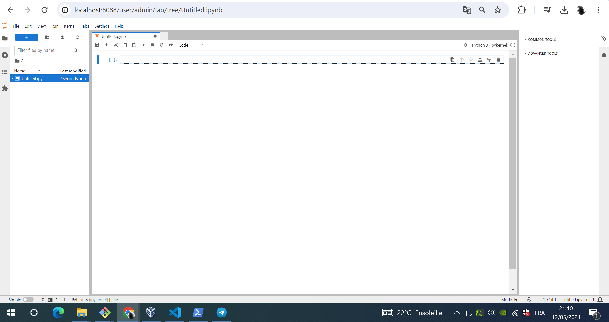
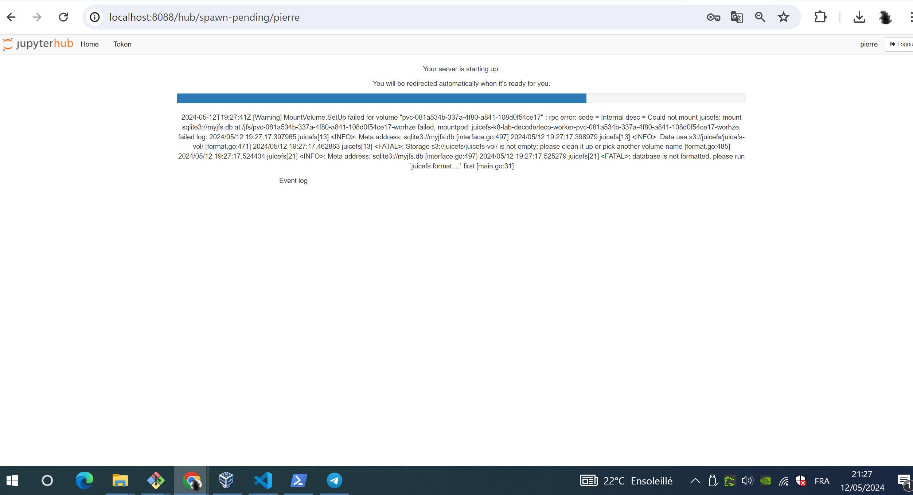
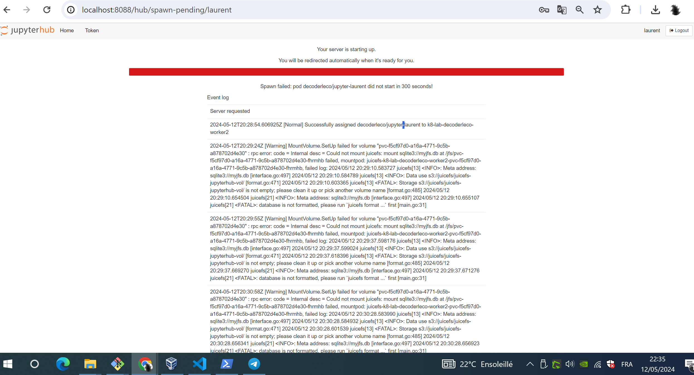

# THe JuiceFS CSI driver

This one definitely works!! awesome!!

* I run the commands in `ops.sh`: the last command stays hanging, it looks like its a service, its a mount point, i found right after, actually i need to use the `-d` option which runs the mount command in the background and its already permanent, its really all great!
* then I run all that  is in `csi.sh`:
  * it ends with a test deployment of a very simple deployment of a pod
  * and it works great
  * as far as i understood, i have then 10 Gigabytes of storage available so 1 or 2 Gigabytes for each jupyter lab i'd say... see commented notes in each script.

I also quickly saw that obviously juicefs is particularly targeted for data engineering in the AI context: well perfect for us!!

Now i'll have to:

* automate with terraform in that simple form of provision, to confirm it's fine and enough for deploying jupyterhub.

* after that i will need to improve the juicefs csi driver so its production ready (a biggger minio, but surely juicefs distributed with redis intead of sqlite, abd still minio for `s3`, see https://juicefs.com/docs/community/getting-started/for_distributed#4-creating-a-file-system): 
  * one intermediate milestone would be a good big docker-compose redis, n a big good minio docker-compose
  * my its really awesome: for further kubernetes csi driver i would want to try the hashicorp vault csi driver to mount secrets in pods!


# Quickest try jupyterhub

https://z2jh.jupyter.org/en/stable/

https://z2jh.jupyter.org/en/stable/jupyterhub/index.html

```bash
helm repo add jupyterhub https://hub.jupyter.org/helm-chart/
helm repo update

# kubectl create ns decoderleco
helm upgrade --cleanup-on-fail \
  --install decoderleco-jupyter jupyterhub/jupyterhub \
  --namespace decoderleco \
  --create-namespace \
  --version=3.3.7


# helm upgrade --cleanup-on-fail \
#   --install decoderleco_jupyter jupyterhub/jupyterhub \
#   --namespace decoderleco \
#   --create-namespace \
#   --version=3.3.7 \
#   --values config.yaml

```

Result: Wow! Its working very quickly! Metallb assigns the JUpyterHub an external load balancer IP successfully! : 

```bash
ubuntu@DecoderLecoCadeauBOB:~/jupyterhub_test$ kubectl get all -n decoderleco
NAME                                  READY   STATUS    RESTARTS   AGE
pod/continuous-image-puller-g99kn     1/1     Running   0          2m25s
pod/continuous-image-puller-ps4qw     1/1     Running   0          2m25s
pod/hub-7499b895d8-7ctbh              1/1     Running   0          2m24s
pod/proxy-76b97db756-262r9            1/1     Running   0          2m24s
pod/user-scheduler-56bc7cbfbb-knhmb   1/1     Running   0          2m24s
pod/user-scheduler-56bc7cbfbb-xrcwd   1/1     Running   0          2m24s

NAME                   TYPE           CLUSTER-IP      EXTERNAL-IP    PORT(S)        AGE
service/hub            ClusterIP      10.96.195.217   <none>         8081/TCP       2m25s
service/proxy-api      ClusterIP      10.96.80.177    <none>         8001/TCP       2m25s
service/proxy-public   LoadBalancer   10.96.222.159   172.18.0.241   80:31271/TCP   2m25s

NAME                                     DESIRED   CURRENT   READY   UP-TO-DATE   AVAILABLE   NODE SELECTOR   AGE
daemonset.apps/continuous-image-puller   2         2         2       2            2           <none>          2m25s

NAME                             READY   UP-TO-DATE   AVAILABLE   AGE
deployment.apps/hub              1/1     1            1           2m25s
deployment.apps/proxy            1/1     1            1           2m25s
deployment.apps/user-scheduler   2/2     2            2           2m25s

NAME                                        DESIRED   CURRENT   READY   AGE
replicaset.apps/hub-7499b895d8              1         1         1       2m25s
replicaset.apps/proxy-76b97db756            1         1         1       2m25s
replicaset.apps/user-scheduler-56bc7cbfbb   2         2         2       2m25s

NAME                                READY   AGE
statefulset.apps/user-placeholder   0/0     2m25s
ubuntu@DecoderLecoCadeauBOB:~/jupyterhub_test$

```

Omy! I then threw an SSH tunnel and could access the jupyterhub! :o : 

```bash
ssh -L 8088:172.18.0.241:80 -i ~/.decoderleco/compte.oci.a.bobo/id_rsa ubuntu@141.145.203.41
```

And I could wow login with `admin` / `admin` user password creds :o (actually i can type anything for user password it automatically creates the user, i just need to remember username and passwords) : 



After i created the first notebook i could check and of course understand its not using the juicefs storage class for storaing the notebooks, so that's what i want to first change probably: 

https://z2jh.jupyter.org/en/stable/jupyterhub/customizing/user-storage.html


```bash

mkdir -p ./jupyterhub_custom/

cd ./jupyterhub_custom/


cat <<EOF >./config.yaml
singleuser:
  storage:
    capacity: 2Gi
    dynamic:
      storageClass: juicefs-sc
EOF

helm upgrade --cleanup-on-fail \
  --install decoderleco-jupyter jupyterhub/jupyterhub \
  --namespace decoderleco \
  --create-namespace \
  --version=3.3.7 \
  --values config.yaml

```

Omy omy I have an error, but it is sooo clear what needs to be done with juicefs to fix the thing and it will WORK!!!

(probably i will just have to create another storage class and it will be goooddd)




```bash


export minio_container_name="minio"
# docker network connect "kind" "${minio_container_name}"
export MINIO_BUCKET_URL="http://${minio_container_name}:9000/juicefs"
export MINIO_ACCESS_KEY="f3LZ9oci8OkyVc6eHmyw"
export MINIO_SECRET_KEY="ay8oI3CHTjGRtw1t1ytVlfa4XkJs0VaNwRo5d2VW"

export JUICEFS_METADATA_URL="sqlite3://myjfs.db"

export JUPYTERHUB_K8S_NS="decoderleco"
figlet 'JuiceFS Test'
cat <<EOF >./juicefs_jupyterhub_storage_class.yaml
apiVersion: v1
kind: Secret
metadata:
  name: juicefs-jupyterhub-secret
  # name: juicefs-secret
  namespace: ${JUPYTERHUB_K8S_NS}
  # namespace: default
type: Opaque
stringData:
  name: juicefs-jupyterhub-vol     # The JuiceFS file system name
  access-key: ${MINIO_ACCESS_KEY}  # Object storage credentials
  secret-key: ${MINIO_SECRET_KEY}  # Object storage credentials
  # follows are for JuiceFS enterprise
  # token: ${JUICEFS_TOKEN}        # Token used to authenticate against JuiceFS Volume
  # follows are for JuiceFS community
  metaurl: ${JUICEFS_METADATA_URL} # Connection URL for metadata engine.
  storage: s3                      # Object storage type, such as s3, gs, oss.
  bucket: ${MINIO_BUCKET_URL}      # Bucket URL of object storage.
---
apiVersion: storage.k8s.io/v1
kind: StorageClass
metadata:
  name: juicefs-jupyterhub
  namespace: ${JUPYTERHUB_K8S_NS}
provisioner: csi.juicefs.com
parameters:
  csi.storage.k8s.io/provisioner-secret-name: juicefs-jupyterhub-secret
  csi.storage.k8s.io/provisioner-secret-namespace: ${JUPYTERHUB_K8S_NS}
  csi.storage.k8s.io/node-publish-secret-name: juicefs-jupyterhub-secret
  csi.storage.k8s.io/node-publish-secret-namespace: ${JUPYTERHUB_K8S_NS}
EOF

kubectl apply -f ./juicefs_jupyterhub_storage_class.yaml

cat <<EOF >./config.yaml
singleuser:
  storage:
    capacity: 2Gi
    dynamic:
      storageClass: juicefs-jupyterhub
EOF
# helm delete decoderleco-jupyter -n decoderleco
helm upgrade --cleanup-on-fail \
  --install decoderleco-jupyter jupyterhub/jupyterhub \
  --namespace decoderleco \
  --create-namespace \
  --version=3.3.7 \
  --values config.yaml

# below that would be an example PVC using
# the above defined storage class:

cat <<EOF >./example-pvc.yaml
# DONT APPLY THIS PVC
---
apiVersion: v1
kind: PersistentVolumeClaim
metadata:
  name: juicefs-test-pvc
  namespace: default
spec:
  accessModes:
  - ReadWriteMany
  resources:
    requests:
      storage: 100
      # storage: 10Pi
  storageClassName: juicefs-jupyterhub
EOF


```

Ok, so just doing what i did above didnt work but well on worst case I think if i create 2 different filesystems and 2 juicefs mount point it should work , here its the multiple applicatipns requiring pvc with same storage class or different storage classes we'll see.

it still is awesome and we'll see about how to manage several users


```bash


export minio_container_name="minio"
# docker network connect "kind" "${minio_container_name}"
export MINIO_BUCKET_URL="http://${minio_container_name}:9000/juicefs"
export MINIO_ACCESS_KEY="f3LZ9oci8OkyVc6eHmyw"
export MINIO_SECRET_KEY="ay8oI3CHTjGRtw1t1ytVlfa4XkJs0VaNwRo5d2VW"

export JUICEFS_METADATA_URL="sqlite3://myjfs.db"

export JUPYTERHUB_K8S_NS="decoderleco"
figlet 'JuiceFS Test'
cat <<EOF >./juicefs_jupyterhub_storage_class.yaml
apiVersion: v1
kind: Secret
metadata:
  name: juicefs-secret
  namespace: default
type: Opaque
stringData:
  name: juicefs-jupyterhub-vol     # The JuiceFS file system name
  access-key: ${MINIO_ACCESS_KEY}  # Object storage credentials
  secret-key: ${MINIO_SECRET_KEY}  # Object storage credentials
  # follows are for JuiceFS enterprise
  # token: ${JUICEFS_TOKEN}        # Token used to authenticate against JuiceFS Volume
  # follows are for JuiceFS community
  metaurl: ${JUICEFS_METADATA_URL} # Connection URL for metadata engine.
  storage: s3                      # Object storage type, such as s3, gs, oss.
  bucket: ${MINIO_BUCKET_URL}      # Bucket URL of object storage.
---
apiVersion: storage.k8s.io/v1
kind: StorageClass
metadata:
  name: juicefs-jupyterhub
provisioner: csi.juicefs.com
parameters:
  csi.storage.k8s.io/provisioner-secret-name: juicefs-secret
  csi.storage.k8s.io/provisioner-secret-namespace: default
  csi.storage.k8s.io/node-publish-secret-name: juicefs-secret
  csi.storage.k8s.io/node-publish-secret-namespace: default
EOF

kubectl apply -f ./juicefs_jupyterhub_storage_class.yaml

cat <<EOF >./config.yaml
singleuser:
  storage:
    capacity: 2Gi
    dynamic:
      storageClass: juicefs-jupyterhub
EOF
# helm delete decoderleco-jupyter -n decoderleco
helm upgrade --cleanup-on-fail \
  --install decoderleco-jupyter jupyterhub/jupyterhub \
  --namespace decoderleco \
  --create-namespace \
  --version=3.3.7 \
  --values config.yaml

# below that would be an example PVC using
# the above defined storage class:

cat <<EOF >./example-pvc.yaml
# DONT APPLY THIS PVC
---
apiVersion: v1
kind: PersistentVolumeClaim
metadata:
  name: juicefs-test-pvc
  namespace: default
spec:
  accessModes:
  - ReadWriteMany
  resources:
    requests:
      storage: 100
      # storage: 10Pi
  storageClassName: juicefs-jupyterhub
EOF


```


and with the above config it IT WOOORKKSSSS

 where is the notebook saved ? 
* in the minio bucket in one chunk file i found some json metadata about the notebook: 

```
{"data":{"layout-restorer:data":{"main":{"dock":{"type":"tab-area","currentIndex":1,"widgets":["notebook:premier_notebook_de_pierre.ipynb"]},"current":"notebook:premier_notebook_de_pierre.ipynb"},"down":{"size":0,"widgets":[]},"left":{"collapsed":false,"visible":true,"current":"filebrowser","widgets":["filebrowser","running-sessions","@jupyterlab/toc:plugin","extensionmanager.main-view"],"widgetStates":{"jp-running-sessions":{"sizes":[0.25,0.25,0.25,0.25],"expansionStates":[false,false,false,false]},"extensionmanager.main-view":{"sizes":[0.3333333333333333,0.3333333333333333,0.3333333333333333],"expansionStates":[false,false,false]}}},"right":{"collapsed":true,"visible":true,"widgets":["jp-property-inspector","debugger-sidebar"],"widgetStates":{"jp-debugger-sidebar":{"sizes":[0.2,0.2,0.2,0.2,0.2],"expansionStates":[false,false,false,false,false]}}},"relativeSizes":[0.1353211009174312,0.8646788990825688,0],"top":{"simpleVisibility":true}},"notebook:premier_notebook_de_pierre.ipynb":{"data":{"path":"premier_notebook_de_pierre.ipynb","factory":"Notebook"}}},"metadata":{"id":"default"}}
```

* and on filesystem mounted by juicefs outside cluster : 

```bash
ls -alh /juicefs_data/disk
# i don't find no files here ! ...
```

Very important too: Ok this time it works, but if i try login in with a second user who is going to spin up another pod, and use same juicefs storage class... It crashes:



about that i found : 

* https://github.com/juicedata/juicefs-csi-driver/issues/405
* https://juicefs.com/docs/csi/guide/resource-optimization/#share-mount-pod-for-the-same-storageclass


I quickly only executed :

```bash
kubectl -n kube-system set env -c juicefs-plugin daemonset/juicefs-csi-node STORAGE_CLASS_SHARE_MOUNT=true
```

but It didnt work, i might have to change my values in `config.yaml` it obviously mentions for single user ... might vhave to do like https://github.com/juicedata/juicefs-csi-driver/issues/405
