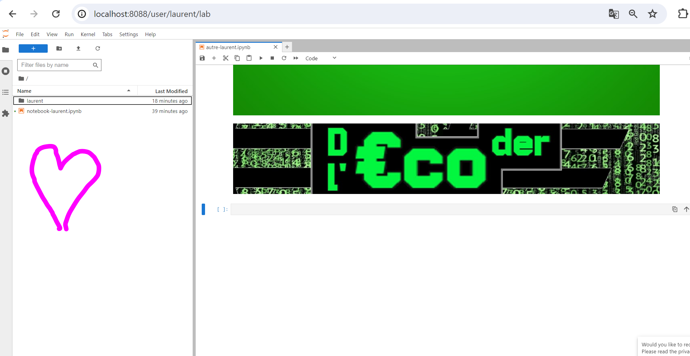
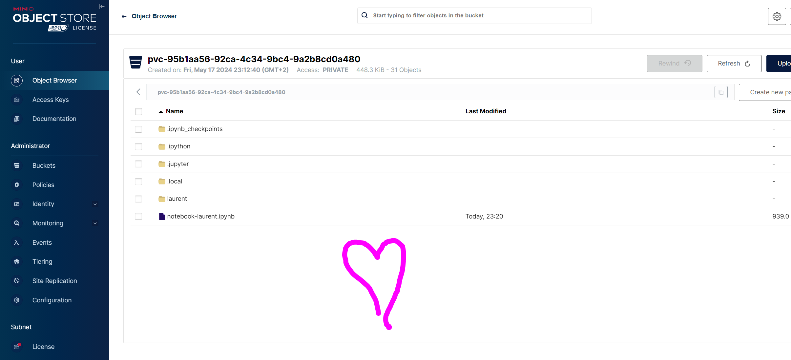

# The Yandex s3 CSI driver

* <https://github.com/yandex-cloud/k8s-csi-s3>


## First result

Okay, I get one error because i am on ARM 64, not amd64:

```bash
~/yandex-csi-s3$ kubectl logs service/csi-s3-provisioner -n kube-system
Defaulted container "csi-provisioner" out of: csi-provisioner, csi-s3
exec /csi-provisioner: exec format error

```

Here are the images used by the helm chart to deploy the csi driver:

```bash
~/yandex-csi-s3/build/k8s-csi-s3-arm64$ kubectl describe pod/csi-s3-provisioner-0 -n kube-system | grep 'Image:'
    Image:         cr.yandex/crp9ftr22d26age3hulg/yandex-cloud/csi-s3/csi-provisioner:v2.1.0
    Image:         cr.yandex/crp9ftr22d26age3hulg/yandex-cloud/csi-s3/csi-s3-driver:0.40.8

```
* In ccc I have found that there are 

* The Chart [`values.yaml`](https://github.com/yandex-cloud/k8s-csi-s3/blob/master/deploy/helm/csi-s3/values.yaml) contains parameters to reset image GUNs:

```Yaml
---
images:
  # Source: quay.io/k8scsi/csi-node-driver-registrar:v1.2.0
  registrar: cr.yandex/crp9ftr22d26age3hulg/yandex-cloud/csi-s3/csi-node-driver-registrar:v1.2.0
  # Source: quay.io/k8scsi/csi-provisioner:v2.1.0
  provisioner: cr.yandex/crp9ftr22d26age3hulg/yandex-cloud/csi-s3/csi-provisioner:v2.1.0
  # Main image
  csi: cr.yandex/crp9ftr22d26age3hulg/yandex-cloud/csi-s3/csi-s3-driver:0.40.8

storageClass:
  # Specifies whether the storage class should be created
  create: true
  # Name
  name: csi-s3
  # Use a single bucket for all dynamically provisioned persistent volumes
  singleBucket: ""
  # mounter to use - either geesefs, s3fs or rclone (default geesefs)
  mounter: geesefs
  # GeeseFS mount options
  mountOptions: "--memory-limit 1000 --dir-mode 0777 --file-mode 0666"
  # Volume reclaim policy
  reclaimPolicy: Delete
  # Annotations for the storage class
  # Example:
  # annotations:
  #   storageclass.kubernetes.io/is-default-class: "true"
  annotations: {}

secret:
  # Specifies whether the secret should be created
  create: true
  # Name of the secret
  name: csi-s3-secret
  # S3 Access Key
  accessKey: ""
  # S3 Secret Key
  secretKey: ""
  # Endpoint
  endpoint: https://storage.yandexcloud.net
  # Region
  region: ""

tolerations:
  all: false
  node: []
  controller: []

nodeSelector: {}

kubeletPath: /var/lib/kubelet
```

So to sum up:
* I don't need the _registrar_ docker image
* I need 2 docker images:
  * `cr.yandex/crp9ftr22d26age3hulg/yandex-cloud/csi-s3/csi-provisioner:v2.1.0`:
    * That one i can replace it by `quay.io/k8scsi/csi-provisioner:v2.1.0`.
    * I checked that I don't need to rebuild that image, it already exist for `arm64`, by running `docker pull --platform linux/arm64 quay.io/k8scsi/csi-provisioner:v2.1.0`. ERRATA: I found out that actually im wrong there does not seem to be an ARM64 image available so I found 

```bash
$ docker pull --platform linux/arm64 kunde21/k8s-provisioner:v2.2.0-arm64
v2.2.0-arm64: Pulling from kunde21/k8s-provisioner
d3784b541195: Pull complete
9c6bdd42d976: Pull complete
Digest: sha256:26e46ccaae80daf47e71dada4880c982289dc8de048cec485985a47655014969
Status: Downloaded newer image for kunde21/k8s-provisioner:v2.2.0-arm64
docker.io/kunde21/k8s-provisioner:v2.2.0-arm64

```

  * `cr.yandex/crp9ftr22d26age3hulg/yandex-cloud/csi-s3/csi-s3-driver:0.40.8`:
    * that one i could rebuild it from source code for `ARM64` thanks to <https://github.com/motoki317/k8s-csi-s3.git>
* About the _registrar_ image, I found out a very interesting fact, which makes me think it's deprecated, and by the fact not used by the latest helm chart:

```bash
$ docker pull --platform linux/arm64 quay.io/k8scsi/csi-node-driver-registrar:v1.2.0
v1.2.0: Pulling from k8scsi/csi-node-driver-registrar
[DEPRECATION NOTICE] Docker Image Format v1 and Docker Image manifest version 2, schema 1 support is disabled by default and will be removed in an upcoming release. Suggest the author of quay.io/k8scsi/csi-node-driver-registrar:v1.2.0 to upgrade the image to the OCI Format or Docker Image manifest v2, schema 2. More information at https://docs.docker.com/go/deprecated-image-specs/
$ $ docker pull --platform linux/arm64 quay.io/k8scsi/csi-node-driver-registrar:v2.1.0
v2.1.0: Pulling from k8scsi/csi-node-driver-registrar
e59bd8947ac7: Pull complete
1ef5910f4feb: Pull complete
Digest: sha256:fb4f139b51ae5b449a132949d7f3d839fa9ea5c57df1c1cd61f781389fdacefb
Status: Downloaded newer image for quay.io/k8scsi/csi-node-driver-registrar:v2.1.0
image with reference quay.io/k8scsi/csi-node-driver-registrar:v2.1.0 was found but does not match the specified platform: wanted linux/arm64, actual: linux/amd64


```

And I will now re-deploy the helm chart like this:

```bash
# --- # --- # --- 
# --- # --- # --- 
# ---  PREPARE IMAGES FOR THE HELM CHART

# --
# - first image: the CSI driver i re-built
export REBUILT_CSI_DRIVER_IMG_NAME=$(docker images | grep yandex | awk '{ print $1 }')
export REBUILT_CSI_DRIVER_IMG_TAG=$(docker images | grep yandex | awk '{ print $2 }')
export REBUILT_CSI_DRIVER_GUN="${REBUILT_CSI_DRIVER_IMG_NAME}:${REBUILT_CSI_DRIVER_IMG_TAG}"

echo "REBUILT_CSI_DRIVER_GUN=[${REBUILT_CSI_DRIVER_GUN}]"

export CSI_DRIVER_GUN_TO_DEPLOY="localhost:5001/${REBUILT_CSI_DRIVER_GUN}-arm64"

docker tag "${REBUILT_CSI_DRIVER_GUN}" "${CSI_DRIVER_GUN_TO_DEPLOY}"

docker push "${CSI_DRIVER_GUN_TO_DEPLOY}"

# --
# - second image: the CSI provisioner
# ok not easy to find one for arm64, so i try that one found randomly on dockerhub
export PROVISIONER_IMG_GUN="kunde21/k8s-provisioner:v2.2.0-arm64"
export CSI_PROVISIONER_GUN_TO_DEPLOY="localhost:5001/csi-s3/csi-provisioner:v2.2.0-arm64"

docker pull --platform linux/arm64 "${PROVISIONER_IMG_GUN}"

docker tag "${PROVISIONER_IMG_GUN}" "${CSI_PROVISIONER_GUN_TO_DEPLOY}"

docker push "${CSI_PROVISIONER_GUN_TO_DEPLOY}"


# --
# - third image: the CSI registrar
# https://hub.docker.com/r/longhornio/csi-node-driver-registrar/tags?page=&page_size=&ordering=&name=arm64
export REGISTRAR_IMG_GUN="longhornio/csi-node-driver-registrar:v2.3.0-arm64"
export CSI_REGISTRAR_GUN_TO_DEPLOY="localhost:5001/csi-s3/csi-node-driver-registrar:v2.3.0-arm64"

docker pull --platform linux/arm64 "${REGISTRAR_IMG_GUN}"

docker tag "${REGISTRAR_IMG_GUN}" "${CSI_REGISTRAR_GUN_TO_DEPLOY}"

docker push "${CSI_REGISTRAR_GUN_TO_DEPLOY}"


# --- # --- # --- 
# --- # --- # --- 
# ---  And re-deploy the helm Chart


export minio_container_name="minio"
# export MINIO_BUCKET_URL="http://${minio_container_name}:9000/juicefs"
export MINIO_ENDPOINT="http://${minio_container_name}:9000"
export MINIO_ACCESS_KEY="f7a5aJLswKEwYcmZAGXW"
export MINIO_SECRET_KEY="P6KujEDBpEoud9oBwHHGzCdzSEAm3P1TxZnzARtT"
docker network connect "kind" "${minio_container_name}"


# helm repo add yandex-s3 https://yandex-cloud.github.io/k8s-csi-s3/charts

helm delete csi-s3 -n kube-system || true

helm install csi-s3 yandex-s3/csi-s3 \
     -n kube-system \
     --set secret.accessKey=${MINIO_ACCESS_KEY} \
     --set secret.secretKey=${MINIO_SECRET_KEY} \
     --set secret.endpoint=${MINIO_ENDPOINT} \
     --set images.provisioner=${ccc} \
     --set images.csi=${ccc}


```

ANd it works!


## Jupyterhub


Oh purée ça marche presque avec le s3 csi driver !!! j'ai juste une erreur de permissions de fichiers dans le pod du notebook de pierre!!

On est à deux doigts!!!


```bash
:~/yandex-csi-s3/build/k8s-csi-s3-arm64/jupyterhub_custom$ kubectl get all -n decoderleco
NAME                                  READY   STATUS    RESTARTS      AGE
pod/continuous-image-puller-mjqjt     1/1     Running   0             3m33s
pod/continuous-image-puller-qgvm5     1/1     Running   0             3m33s
pod/hub-77545bbd4c-jjqjv              1/1     Running   0             3m33s
pod/jupyter-pierre                    0/1     Error     2 (14s ago)   19s
pod/proxy-556f4f8798-vc66n            1/1     Running   0             3m33s
pod/user-scheduler-569b55d7f8-fwrjk   1/1     Running   0             3m33s
pod/user-scheduler-569b55d7f8-xscxw   1/1     Running   0             3m33s

NAME                   TYPE           CLUSTER-IP      EXTERNAL-IP    PORT(S)        AGE
service/hub            ClusterIP      10.96.115.232   <none>         8081/TCP       3m34s
service/proxy-api      ClusterIP      10.96.40.173    <none>         8001/TCP       3m34s
service/proxy-public   LoadBalancer   10.96.176.190   172.18.0.241   80:32583/TCP   3m34s

NAME                                     DESIRED   CURRENT   READY   UP-TO-DATE   AVAILABLE   NODE SELECTOR   AGE
daemonset.apps/continuous-image-puller   2         2         2       2            2           <none>          3m34s

NAME                             READY   UP-TO-DATE   AVAILABLE   AGE
deployment.apps/hub              1/1     1            1           3m33s
deployment.apps/proxy            1/1     1            1           3m33s
deployment.apps/user-scheduler   2/2     2            2           3m34s

NAME                                        DESIRED   CURRENT   READY   AGE
replicaset.apps/hub-77545bbd4c              1         1         1       3m33s
replicaset.apps/proxy-556f4f8798            1         1         1       3m33s
replicaset.apps/user-scheduler-569b55d7f8   2         2         2       3m33s

NAME                                READY   AGE
statefulset.apps/user-placeholder   0/0     3m33s
ubuntu@MyServer:~/yandex-csi-s3/build/k8s-csi-s3-arm64/jupyterhub_custom$ kubectl logs pod/jupyter-pierre -n decoderleco
Defaulted container "notebook" out of: notebook, block-cloud-metadata (init)
[W 2024-05-17 20:39:04.979 ServerApp] A `_jupyter_server_extension_points` function was not found in nbclassic. Instead, a `_jupyter_server_extension_paths` function was found and will be used for now. This function name will be deprecated in future releases of Jupyter Server.
[I 2024-05-17 20:39:04.982 ServerApp] jupyter_lsp | extension was successfully linked.
[I 2024-05-17 20:39:04.986 ServerApp] jupyter_server_terminals | extension was successfully linked.
[I 2024-05-17 20:39:04.986 JupyterHubSingleUser] Starting jupyterhub single-user server extension version 4.1.5
[I 2024-05-17 20:39:04.987 JupyterHubSingleUser] Using default url from server extension lab: /lab
[I 2024-05-17 20:39:04.989 ServerApp] jupyterhub | extension was successfully linked.
[W 2024-05-17 20:39:04.991 LabApp] 'extra_template_paths' was found in both NotebookApp and ServerApp. This is likely a recent change. This config will only be set in NotebookApp. Please check if you should also config these traits in ServerApp for your purpose.
[I 2024-05-17 20:39:04.994 ServerApp] jupyterlab | extension was successfully linked.
[W 2024-05-17 20:39:04.995 NotebookApp] 'extra_template_paths' was found in both NotebookApp and ServerApp. This is likely a recent change. This config will only be set in NotebookApp. Please check if you should also config these traits in ServerApp for your purpose.
[I 2024-05-17 20:39:04.997 ServerApp] nbclassic | extension was successfully linked.
[I 2024-05-17 20:39:04.998 ServerApp] nbgitpuller | extension was successfully linked.
[I 2024-05-17 20:39:05.248 ServerApp] notebook_shim | extension was successfully linked.
/usr/local/lib/python3.11/site-packages/jupyter_server/serverapp.py:2235: JupyterServerAuthWarning: Core endpoints without @allow_unauthenticated, @ws_authenticated, nor @web.authenticated:
- GET of JupyterHubLogoutHandler registered for /user/pierre/logout
- GET of JupyterHubOAuthCallbackHandler registered for /user/pierre/oauth_callback
  self.web_app = ServerWebApplication(
[I 2024-05-17 20:39:05.264 ServerApp] notebook_shim | extension was successfully loaded.
[I 2024-05-17 20:39:05.267 ServerApp] jupyter_lsp | extension was successfully loaded.
[I 2024-05-17 20:39:05.268 ServerApp] jupyter_server_terminals | extension was successfully loaded.
[I 2024-05-17 20:39:05.275 JupyterHubSingleUser] Updating Hub with activity every 300 seconds
[I 2024-05-17 20:39:05.275 ServerApp] jupyterhub | extension was successfully loaded.
[I 2024-05-17 20:39:05.277 LabApp] JupyterLab extension loaded from /usr/local/lib/python3.11/site-packages/jupyterlab
[I 2024-05-17 20:39:05.277 LabApp] JupyterLab application directory is /usr/local/share/jupyter/lab
[I 2024-05-17 20:39:05.278 LabApp] Extension Manager is 'pypi'.
[I 2024-05-17 20:39:05.288 ServerApp] jupyterlab | extension was successfully loaded.
[I 2024-05-17 20:39:05.293 ServerApp] nbclassic | extension was successfully loaded.
[I 2024-05-17 20:39:05.295 ServerApp] nbgitpuller | extension was successfully loaded.
[I 2024-05-17 20:39:05.295 ServerApp] Serving notebooks from local directory: /home/jovyan
[I 2024-05-17 20:39:05.296 ServerApp] Skipped non-installed server(s): bash-language-server, dockerfile-language-server-nodejs, javascript-typescript-langserver, jedi-language-server, julia-language-server, pyright, python-language-server, python-lsp-server, r-languageserver, sql-language-server, texlab, typescript-language-server, unified-language-server, vscode-css-languageserver-bin, vscode-html-languageserver-bin, vscode-json-languageserver-bin, yaml-language-server
[I 2024-05-17 20:39:05.296 ServerApp] Jupyter Server 2.13.0 is running at:
[I 2024-05-17 20:39:05.296 ServerApp] http://jupyter-pierre:8888/user/pierre/lab?token=...
[I 2024-05-17 20:39:05.296 ServerApp]     http://127.0.0.1:8888/user/pierre/lab?token=...
[I 2024-05-17 20:39:05.296 ServerApp] Use Control-C to stop this server and shut down all kernels (twice to skip confirmation).

  _   _          _      _
 | | | |_ __  __| |__ _| |_ ___
 | |_| | '_ \/ _` / _` |  _/ -_)
  \___/| .__/\__,_\__,_|\__\___|
       |_|

Read the migration plan to Notebook 7 to learn about the new features and the actions to take if you are using extensions.

https://jupyter-notebook.readthedocs.io/en/latest/migrate_to_notebook7.html

Please note that updating to Notebook 7 might break some of your extensions.

Traceback (most recent call last):
  File "/usr/local/bin/jupyterhub-singleuser", line 8, in <module>
    sys.exit(main())
             ^^^^^^
  File "/usr/local/lib/python3.11/site-packages/jupyter_server/extension/application.py", line 622, in launch_instance
    serverapp.start()
  File "/usr/local/lib/python3.11/site-packages/jupyter_server/serverapp.py", line 3118, in start
    self.start_app()
  File "/usr/local/lib/python3.11/site-packages/jupyter_server/serverapp.py", line 3019, in start_app
    self.write_server_info_file()
  File "/usr/local/lib/python3.11/site-packages/jupyter_server/serverapp.py", line 2825, in write_server_info_file
    with secure_write(self.info_file) as f:
  File "/usr/local/lib/python3.11/contextlib.py", line 137, in __enter__
    return next(self.gen)
           ^^^^^^^^^^^^^^
  File "/usr/local/lib/python3.11/site-packages/jupyter_core/paths.py", line 1007, in secure_write
    raise RuntimeError(msg)
RuntimeError: Permissions assignment failed for secure file: '/home/jovyan/.local/share/jupyter/runtime/jpserver-13.json'. Got '0o666' instead of '0o0600'.
ubuntu@MyServer:~/yandex-csi-s3/build/k8s-csi-s3-arm64/jupyterhub_custom$

```

exactement la même erreur sur github:
https://github.com/jupyter/notebook/issues/5058#issuecomment-554682762

masi aussi : 
* https://github.com/minio/minio/issues/9223

tiens la soluce c'est peut-être un [upgrade image qui fait un fix-permissions](https://github.com/search?q=repo%3Ajupyter%2Fdocker-stacks%20fix-permissions&type=code) mais:
* mon jupyterhub sans le csi driver s3 il était parfaitement opérationnel
* du coup c'est le minio qui fait ça: les permissions dans le contener mino ?


Tiens d'ailleurs `kubectl logs service/csi-s3-provisioner -n kube-system` me donne:

```bash
I0517 20:36:50.413380       1 controller.go:1332] provision "decoderleco/claim-pierre" class "csi-s3": started
I0517 20:36:50.415335       1 event.go:282] Event(v1.ObjectReference{Kind:"PersistentVolumeClaim", Namespace:"decoderleco", Name:"claim-pierre", UID:"4369cb5c-475b-4cf7-8800-9f83d5326ada", APIVersion:"v1", ResourceVersion:"31103", FieldPath:""}): type: 'Normal' reason: 'Provisioning' External provisioner is provisioning volume for claim "decoderleco/claim-pierre"
I0517 20:36:50.479382       1 controller.go:763] create volume rep: {CapacityBytes:2147483648 VolumeId:pvc-4369cb5c-475b-4cf7-8800-9f83d5326ada VolumeContext:map[capacity:2147483648 mounter:geesefs options:--memory-limit 1000 --dir-mode 0777 --file-mode 0666] ContentSource:<nil> AccessibleTopology:[] XXX_NoUnkeyedLiteral:{} XXX_unrecognized:[] XXX_sizecache:0}
I0517 20:36:50.480089       1 controller.go:839] successfully created PV pvc-4369cb5c-475b-4cf7-8800-9f83d5326ada for PVC claim-pierre and csi volume name pvc-4369cb5c-475b-4cf7-8800-9f83d5326ada
I0517 20:36:50.480107       1 controller.go:1439] provision "decoderleco/claim-pierre" class "csi-s3": volume "pvc-4369cb5c-475b-4cf7-8800-9f83d5326ada" provisioned
I0517 20:36:50.480124       1 controller.go:1456] provision "decoderleco/claim-pierre" class "csi-s3": succeeded
I0517 20:36:50.488219       1 event.go:282] Event(v1.ObjectReference{Kind:"PersistentVolumeClaim", Namespace:"decoderleco", Name:"claim-pierre", UID:"4369cb5c-475b-4cf7-8800-9f83d5326ada", APIVersion:"v1", ResourceVersion:"31103", FieldPath:""}): type: 'Normal' reason: 'ProvisioningSucceeded' Successfully provisioned volume pvc-4369cb5c-475b-4cf7-8800-9f83d5326ada

```


ok j'ai peut-être une soluce avec :

* https://github.com/jupyter/notebook/issues/5058#issuecomment-583672960
* https://github.com/jupyter/notebook/issues/5058#issuecomment-584734585

> with jupyter core `4.6.2` you can use the `JUPYTER_ALLOW_INSECURE_WRITES=true` environment variable now to opt out of secure writes. This should remove the error but add a warning and allow for execution to progress.

https://z2jh.jupyter.org/en/stable/jupyterhub/customizing/user-environment.html#choose-and-use-an-existing-docker-image


### OK GENIAL CA MARCHE MAIS

le seul truc qui me chiffonne là, c'est que le notebooks que je créée avec la webui, je les vois pas qui sont sauvegardés dans le bucket minio.

Dans kubernetes pourtant dans le pod, je les vois:

```bash
ubuntu@MyServer:~/yandex-csi-s3/build/k8s-csi-s3-arm64/jupyterhub_custom$ kubectl -n decoderleco exec pod/jupyter-laurent -c notebook -- sh -c "pwd && ls -alh && df -h "
/home/jovyan
total 13K
drwxrwxrwx 2 root root 4.0K May 17 21:35 .
drwxr-xr-x 1 root root 4.0K Apr  9 05:16 ..
drwxrwxrwx 2 root root    0 May 17 21:20 .ipynb_checkpoints
drwxrwxrwx 2 root root    0 May 17 21:24 .ipython
drwxrwxrwx 2 root root    0 May 17 21:35 .jupyter
drwxrwxrwx 2 root root    0 May 17 21:35 .local
drwxrwxrwx 2 root root 4.0K May 17 21:35 laurent
-rw-rw-rw- 1 root root  939 May 17 21:20 notebook-laurent.ipynb
Filesystem                                Size  Used Avail Use% Mounted on
overlay                                    45G   26G   20G  58% /
tmpfs                                      64M     0   64M   0% /dev
pvc-95b1aa56-92ca-4c34-9bc4-9a2b8cd0a480  1.0P     0  1.0P   0% /home/jovyan
/dev/sda1                                  45G   26G   20G  58% /etc/hosts
shm                                        64M     0   64M   0% /dev/shm
tmpfs                                      12G     0   12G   0% /proc/acpi
tmpfs                                      12G     0   12G   0% /proc/scsi
tmpfs                                      12G     0   12G   0% /sys/firmware
ubuntu@MyServer:~/yandex-csi-s3/build/k8s-csi-s3-arm64/jupyterhub_custom$ kubectl -n decoderleco describe pod/jupyter-laurent -c notebook
error: unknown shorthand flag: 'c' in -c
See 'kubectl describe --help' for usage.
ubuntu@MyServer:~/yandex-csi-s3/build/k8s-csi-s3-arm64/jupyterhub_custom$ kubectl -n decoderleco describe pod/jupyter-laurent
Name:             jupyter-laurent
Namespace:        decoderleco
Priority:         0
Service Account:  default
Node:             k8-lab-decoderleco-worker2/172.18.0.2
Start Time:       Fri, 17 May 2024 21:18:54 +0000
Labels:           app=jupyterhub
                  chart=jupyterhub-3.3.7
                  component=singleuser-server
                  heritage=jupyterhub
                  hub.jupyter.org/network-access-hub=true
                  hub.jupyter.org/servername=
                  hub.jupyter.org/username=laurent
                  release=decoderleco-jupyter
Annotations:      hub.jupyter.org/username: laurent
Status:           Running
IP:               10.244.3.37
IPs:
  IP:  10.244.3.37
Init Containers:
  block-cloud-metadata:
    Container ID:  containerd://5901e3a97923c168d50dc9e27d4f4cbd1c15427f780fa03875b3d5f6acae8fb2
    Image:         quay.io/jupyterhub/k8s-network-tools:3.3.7
    Image ID:      quay.io/jupyterhub/k8s-network-tools@sha256:310daf3451e3c658bcfcba9b37c82a7fd1103c926736063de54d82f4da285eb6
    Port:          <none>
    Host Port:     <none>
    Command:
      iptables
      --append
      OUTPUT
      --protocol
      tcp
      --destination
      169.254.169.254
      --destination-port
      80
      --jump
      DROP
    State:          Terminated
      Reason:       Completed
      Exit Code:    0
      Started:      Fri, 17 May 2024 21:18:55 +0000
      Finished:     Fri, 17 May 2024 21:18:55 +0000
    Ready:          True
    Restart Count:  0
    Environment:    <none>
    Mounts:         <none>
Containers:
  notebook:
    Container ID:  containerd://67a1fe516e9b9d38340833de0cc837daf0818b1c9fe6b517eda81c17ad01cc5d
    Image:         quay.io/jupyterhub/k8s-singleuser-sample:3.3.7
    Image ID:      quay.io/jupyterhub/k8s-singleuser-sample@sha256:0065b16b695d64c31e9af31623b1a949797c93cb06b40021ed07e42b912b17e3
    Port:          8888/TCP
    Host Port:     0/TCP
    Args:
      jupyterhub-singleuser
    State:          Running
      Started:      Fri, 17 May 2024 21:18:56 +0000
    Ready:          True
    Restart Count:  0
    Requests:
      memory:  1073741824
    Environment:
      JPY_API_TOKEN:                           980261cf6a7a42bc9c9df3e8c424ad6f
      JUPYTERHUB_ACTIVITY_URL:                 http://hub:8081/hub/api/users/laurent/activity
      JUPYTERHUB_ADMIN_ACCESS:                 1
      JUPYTERHUB_API_TOKEN:                    980261cf6a7a42bc9c9df3e8c424ad6f
      JUPYTERHUB_API_URL:                      http://hub:8081/hub/api
      JUPYTERHUB_BASE_URL:                     /
      JUPYTERHUB_CLIENT_ID:                    jupyterhub-user-laurent
      JUPYTERHUB_COOKIE_HOST_PREFIX_ENABLED:   0
      JUPYTERHUB_HOST:
      JUPYTERHUB_OAUTH_ACCESS_SCOPES:          ["access:servers!server=laurent/", "access:servers!user=laurent"]
      JUPYTERHUB_OAUTH_CALLBACK_URL:           /user/laurent/oauth_callback
      JUPYTERHUB_OAUTH_CLIENT_ALLOWED_SCOPES:  []
      JUPYTERHUB_OAUTH_SCOPES:                 ["access:servers!server=laurent/", "access:servers!user=laurent"]
      JUPYTERHUB_SERVER_NAME:
      JUPYTERHUB_SERVICE_PREFIX:               /user/laurent/
      JUPYTERHUB_SERVICE_URL:                  http://0.0.0.0:8888/user/laurent/
      JUPYTERHUB_USER:                         laurent
      JUPYTER_ALLOW_INSECURE_WRITES:           true
      JUPYTER_IMAGE:                           quay.io/jupyterhub/k8s-singleuser-sample:3.3.7
      JUPYTER_IMAGE_SPEC:                      quay.io/jupyterhub/k8s-singleuser-sample:3.3.7
      MEM_GUARANTEE:                           1073741824
    Mounts:
      /home/jovyan from volume-laurent (rw)
Conditions:
  Type                        Status
  PodReadyToStartContainers   True
  Initialized                 True
  Ready                       True
  ContainersReady             True
  PodScheduled                True
Volumes:
  volume-laurent:
    Type:        PersistentVolumeClaim (a reference to a PersistentVolumeClaim in the same namespace)
    ClaimName:   claim-laurent
    ReadOnly:    false
QoS Class:       Burstable
Node-Selectors:  <none>
Tolerations:     hub.jupyter.org/dedicated=user:NoSchedule
                 hub.jupyter.org_dedicated=user:NoSchedule
                 node.kubernetes.io/not-ready:NoExecute op=Exists for 300s
                 node.kubernetes.io/unreachable:NoExecute op=Exists for 300s
Events:
  Type    Reason     Age   From                                Message
  ----    ------     ----  ----                                -------
  Normal  Scheduled  20m   decoderleco-jupyter-user-scheduler  Successfully assigned decoderleco/jupyter-laurent to k8-lab-decoderleco-worker2
  Normal  Pulled     20m   kubelet                             Container image "quay.io/jupyterhub/k8s-network-tools:3.3.7" already present on machine
  Normal  Created    20m   kubelet                             Created container block-cloud-metadata
  Normal  Started    20m   kubelet                             Started container block-cloud-metadata
  Normal  Pulled     20m   kubelet                             Container image "quay.io/jupyterhub/k8s-singleuser-sample:3.3.7" already present on machine
  Normal  Created    20m   kubelet                             Created container notebook
  Normal  Started    20m   kubelet                             Started container notebook
ubuntu@MyServer:~/yandex-csi-s3/build/k8s-csi-s3-arm64/jupyterhub_custom$

```

* Et mieux j'ai les `pvc`:

```bash
ubuntu@MyServer:~/yandex-csi-s3/build/k8s-csi-s3-arm64/jupyterhub_custom$ kubectl -n decoderleco get pvc
NAME            STATUS   VOLUME                                     CAPACITY   ACCESS MODES   STORAGECLASS   VOLUMEATTRIBUTESCLASS   AGE
claim-admin     Bound    pvc-265b5b4a-278a-41f1-aa1d-999548ae0ee6   2Gi        RWO            csi-s3         <unset>                 63m
claim-jean      Bound    pvc-f30f0dd3-6438-4715-8bad-d1337ae6d4c0   2Gi        RWO            csi-s3         <unset>                 31m
claim-laurent   Bound    pvc-95b1aa56-92ca-4c34-9bc4-9a2b8cd0a480   2Gi        RWO            csi-s3         <unset>                 33m
claim-pierre    Bound    pvc-4369cb5c-475b-4cf7-8800-9f83d5326ada   2Gi        RWO            csi-s3         <unset>                 69m
hub-db-dir      Bound    pvc-94f1bf92-328b-4093-be49-72f2f8fc3464   1Gi        RWO            standard       <unset>                 29m
ubuntu@MyServer:~/yandex-csi-s3/build/k8s-csi-s3-arm64/jupyterhub_custom$ kubectl -n decoderleco describe pvc/claim-laurent
Name:          claim-laurent
Namespace:     decoderleco
StorageClass:  csi-s3
Status:        Bound
Volume:        pvc-95b1aa56-92ca-4c34-9bc4-9a2b8cd0a480
Labels:        app=jupyterhub
               chart=jupyterhub-3.3.7
               component=singleuser-storage
               heritage=jupyterhub
               hub.jupyter.org/username=laurent
               release=decoderleco-jupyter
Annotations:   hub.jupyter.org/username: laurent
               pv.kubernetes.io/bind-completed: yes
               pv.kubernetes.io/bound-by-controller: yes
               volume.beta.kubernetes.io/storage-class: csi-s3
               volume.beta.kubernetes.io/storage-provisioner: ru.yandex.s3.csi
               volume.kubernetes.io/storage-provisioner: ru.yandex.s3.csi
Finalizers:    [kubernetes.io/pvc-protection]
Capacity:      2Gi
Access Modes:  RWO
VolumeMode:    Filesystem
Used By:       jupyter-laurent
Events:
  Type    Reason                 Age   From                                                                        Message
  ----    ------                 ----  ----                                                                        -------
  Normal  Provisioning           34m   ru.yandex.s3.csi_csi-s3-provisioner-0_f2381a09-472b-499a-be2e-6e6bb1aa2fe1  External provisioner is provisioning volume for claim "decoderleco/claim-laurent"
  Normal  ExternalProvisioning   34m   persistentvolume-controller                                                 Waiting for a volume to be created either by the external provisioner 'ru.yandex.s3.csi' or manually by the system administrator. If volume creation is delayed, please verify that the provisioner is running and correctly registered.
  Normal  ProvisioningSucceeded  34m   ru.yandex.s3.csi_csi-s3-provisioner-0_f2381a09-472b-499a-be2e-6e6bb1aa2fe1  Successfully provisioned volume pvc-95b1aa56-92ca-4c34-9bc4-9a2b8cd0a480

```

PVC:
* access mode on est ok c'est ReadWriteOnce : https://kubernetes.io/docs/concepts/storage/persistent-volumes/#access-modes
* volume mode filsystem ça semble ok aussi...

Et les fichiers ci-dessous je les vois biend ans le bucket minio c ça je comprends pas:

```bash
ubuntu@MyServer:~/yandex-csi-s3/build/k8s-csi-s3-arm64/jupyterhub_custom$ kubectl -n decoderleco exec pod/jupyter-laurent -c notebook -- sh -c "pwd && ls -alh ./.jupyter"
/home/jovyan
total 4.0K
drwxrwxrwx 2 root root    0 May 17 21:40 .
drwxrwxrwx 2 root root 4.0K May 17 21:41 ..
drwxrwxrwx 2 root root    0 May 17 21:40 lab
drwxrwxrwx 2 root root    0 May 17 21:18 labconfig
ubuntu@MyServer:~/yandex-csi-s3/build/k8s-csi-s3-arm64/jupyterhub_custom$ kubectl -n decoderleco exec pod/jupyter-laurent -c notebook -- sh -c "pwd && ls -alh ./.jupyter/lab"
/home/jovyan
total 0
drwxrwxrwx 2 root root 0 May 17 21:40 .
drwxrwxrwx 2 root root 0 May 17 21:40 ..
drwxrwxrwx 2 root root 0 May 17 21:40 workspaces
ubuntu@MyServer:~/yandex-csi-s3/build/k8s-csi-s3-arm64/jupyterhub_custom$ kubectl -n decoderleco exec pod/jupyter-laurent -c notebook -- sh -c "pwd && ls -alh ./.jupyter/lab/workspaces"
/home/jovyan
total 1.5K
drwxrwxrwx 2 root root    0 May 17 21:40 .
drwxrwxrwx 2 root root    0 May 17 21:40 ..
-rw-rw-rw- 1 root root 1.2K May 17 21:40 default-37a8.jupyterlab-workspace
ubuntu@MyServer:~/yandex-csi-s3/build/k8s-csi-s3-arm64/jupyterhub_custom$

```

AHH MAIS ISIII C EST BON C EST JUSTE QUE JE REGARDAIS PAS DANS LE BON BUCKETTTT!!!



